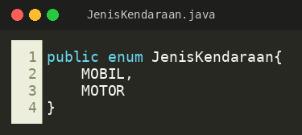
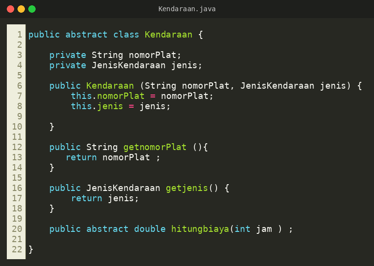
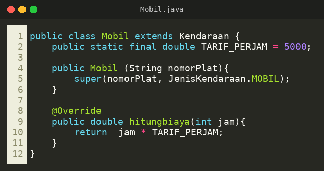
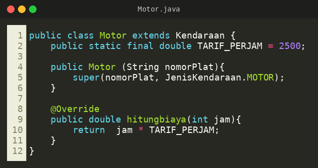
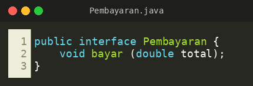
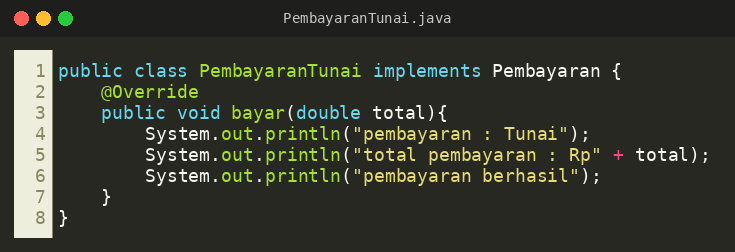
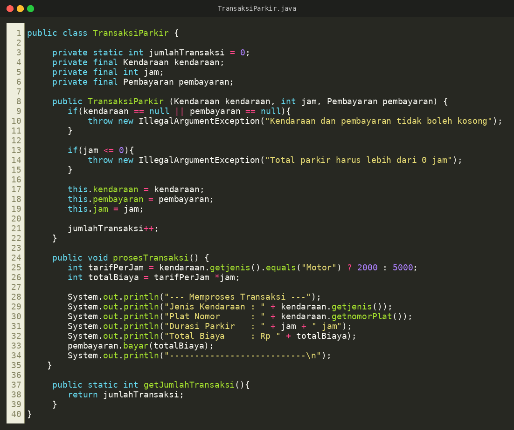
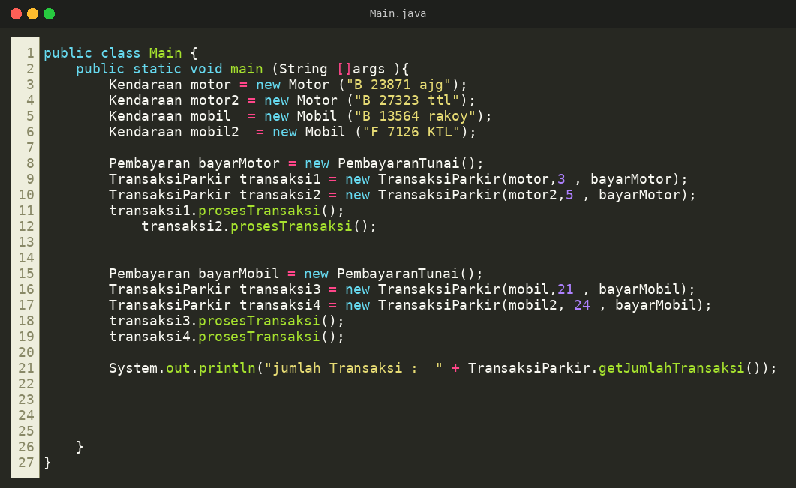
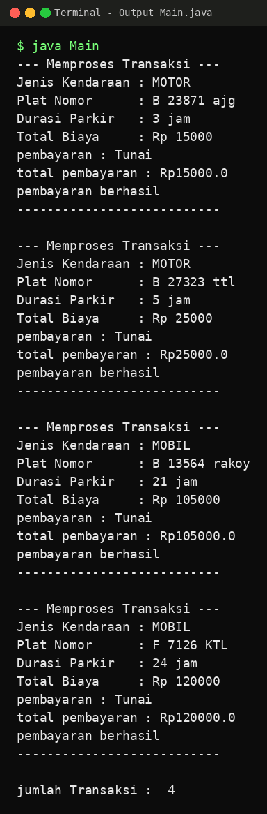

# LAPORAN UTS PRAKTIKUM PEMROGRAMAN BERBASIS OBJEK

| Informasi Proyek | Keterangan |
| :--- | :--- |
| **Mata Kuliah** | Pemrograman Berbasis Objek (PBO) |
| **Kelas** | A |
| **PJ** | [Larasati Dewi] |
| **Tema** | [PARKIR] |
| **Tanggal** | [22 OKTOBER 2026] |
| **Nama** | Muhamad Rasha Zein |
| **NPM** | 4525210042 |

---

## Detail Pengerjaan & Anggota Kelompok

| Nama | NPM | Tugas / Fitur yang Dikerjakan |
| :--- | :--- | :--- |
| [Larasati Dewi] | [4525210037] | [JenisKendaraan.java] |
| [Muchamad Rava Alvriansyah] | [4525210040] | [Motor.java] |
| [Muhamad Rasha Zein] | [4525210042] | [Kendaraan.java] |
| [Adelita Daeli] | [4525210049] | [Kendaraan.java] |
| [Muzaki Arifin] | [4525210051] | [PembayaranTunai.java] |
| [Nabil Nugraha Syamdjaya] | [4525210052] | [TransaksiParkir.java] |
| [Nevilla Ghilar Apryanti] | [4525210054] | [Main.java] |
| [Prevansyah Sjafar] | [4525210057] | [Main.java] |
| [Rakha Athallah Fawwaz] | [4525210061] | [Mobil.java] |
---

## Deskripsi Proyek
> Proyek UTS ini adalah aplikasi konsol (*console*) **sistem parkir** berbasis Java yang dibangun dengan konsep Pemrograman Berbasis Objek. Tujuan utamanya adalah mensimulasikan proses parkir kendaraan, mulai dari pencatatan kendaraan, perhitungan biaya berdasarkan lama parkir, hingga pembayaran. Aplikasi ini menggantikan perhitungan biaya parkir manual yang rawan salah dengan proses yang terstruktur dan mudah dikembangkan.

**Daftar Fitur:**
1. Pengelolaan dua jenis kendaraan (mobil dan motor) menggunakan pewarisan dari kelas abstrak `Kendaraan` dan enum `JenisKendaraan`.
2. Perhitungan biaya parkir berdasarkan durasi (jam) dan tarif per jam masing-masing kendaraan.
3. Pemrosesan transaksi parkir yang mencetak struk (jenis, plat nomor, durasi, dan total biaya).
4. Metode pembayaran fleksibel melalui interface `Pembayaran` (saat ini `PembayaranTunai`, mudah ditambah metode lain).
5. Validasi input transaksi (kendaraan/pembayaran tidak boleh kosong dan durasi harus lebih dari 0 jam).
6. Penghitung jumlah transaksi menggunakan atribut `static`.

---

## 1. Implementasi Java

### 1.1. File: `JenisKendaraan.java`
**Penjelasan Kode:**
> Berupa `enum` yang mendefinisikan dua jenis kendaraan yang diizinkan, yaitu `MOBIL` dan `MOTOR`. Dengan enum, jenis kendaraan bersifat *type-safe* sehingga tidak bisa diisi dengan teks sembarangan dan terhindar dari salah ketik.

**Screenshot Kode:**

### 1.2. File: `Kendaraan.java`
**Penjelasan Kode:**
> Merupakan *abstract class* sebagai induk dari semua kendaraan. Menerapkan **abstraksi** dan **enkapsulasi**: atribut `nomorPlat` dan `jenis` dibuat `private` dan hanya bisa diakses lewat getter. Method `hitungbiaya(int jam)` dideklarasikan `abstract` sehingga setiap subclass wajib mengimplementasikan cara menghitung biayanya sendiri.

**Screenshot Kode:**

### 1.3. File: `Mobil.java`
**Penjelasan Kode:**
> Subclass dari `Kendaraan` (**pewarisan**). Memanggil `super(nomorPlat, JenisKendaraan.MOBIL)` pada konstruktor, menyimpan konstanta `TARIF_PERJAM` sebesar Rp5.000, dan meng-*override* `hitungbiaya()` dengan rumus `jam * TARIF_PERJAM` (**polimorfisme**).

**Screenshot Kode:**

### 1.4. File: `Motor.java`
**Penjelasan Kode:**
> Subclass dari `Kendaraan` untuk sepeda motor. Strukturnya sama dengan `Mobil`, tetapi memakai `JenisKendaraan.MOTOR` dan tarif `TARIF_PERJAM` sebesar Rp2.500 per jam. Method `hitungbiaya()` di-*override* sesuai tarif motor.

**Screenshot Kode:**

### 1.5. File: `Pembayaran.java`
**Penjelasan Kode:**
> Berupa `interface` yang mendefinisikan kontrak metode pembayaran lewat satu method `bayar(double total)`. Dengan interface, metode pembayaran baru (misalnya QRIS atau kartu) dapat ditambahkan tanpa mengubah kelas transaksi (**abstraksi** dan *loose coupling*).

**Screenshot Kode:**

### 1.6. File: `PembayaranTunai.java`
**Penjelasan Kode:**
> Kelas yang mengimplementasikan interface `Pembayaran`. Method `bayar()` di-*override* untuk mencetak informasi bahwa pembayaran dilakukan secara tunai, total yang dibayar, dan status pembayaran berhasil.

**Screenshot Kode:**

### 1.7. File: `TransaksiParkir.java`
**Penjelasan Kode:**
> Kelas yang merepresentasikan satu transaksi parkir. Atribut `kendaraan`, `jam`, dan `pembayaran` bersifat `private final` (**enkapsulasi**). Konstruktor melakukan validasi dan melempar `IllegalArgumentException` jika kendaraan/pembayaran `null` atau durasi `<= 0`. Atribut `static jumlahTransaksi` menghitung total transaksi yang dibuat, dibaca lewat `getJumlahTransaksi()`. Method `prosesTransaksi()` menghitung biaya, mencetak struk, lalu memanggil `pembayaran.bayar()` lewat tipe interface (**polimorfisme** dan *composition*).

**Screenshot Kode:**

### 1.7. File: `Main.java`
**Penjelasan Kode:**
> Titik masuk program. Alurnya: (1) membuat dua objek `Motor` dan dua objek `Mobil` yang disimpan dalam variabel bertipe `Kendaraan` (polimorfisme); (2) membuat objek `PembayaranTunai` yang disimpan sebagai tipe `Pembayaran`; (3) membuat empat `TransaksiParkir` dengan durasi berbeda (3, 5, 21, dan 24 jam); (4) memanggil `prosesTransaksi()` pada setiap transaksi untuk mencetak struk dan memproses pembayaran; (5) menampilkan total transaksi memakai `TransaksiParkir.getJumlahTransaksi()`.

**Screenshot Kode:**

### Output
**Hasil Running Program (Java):**

## 2. Kesimpulan
> Proyek UTS sistem parkir ini berhasil menerapkan konsep utama OOP: **enkapsulasi** (atribut `private` dengan getter), **pewarisan** (`Mobil` dan `Motor` mewarisi `Kendaraan`), **abstraksi** (abstract class `Kendaraan` dan interface `Pembayaran`), serta **polimorfisme** (`hitungbiaya()` dan `bayar()` dipanggil lewat tipe induk/interface). Tema parkir cocok karena kendaraan dan metode pembayaran mudah dimodelkan sebagai objek, dan struktur ini memudahkan penambahan jenis kendaraan atau metode pembayaran baru. Dari sisi evaluasi, perhitungan tarif sebaiknya memanfaatkan `hitungbiaya()` pada masing-masing subclass agar tidak terjadi duplikasi tarif di `TransaksiParkir`. Dari sisi kolaborasi, pembagian tugas per file membuat pengerjaan lebih terorganisir, sementara komunikasi antaranggota tetap diperlukan agar antarkelas terintegrasi dengan baik.
